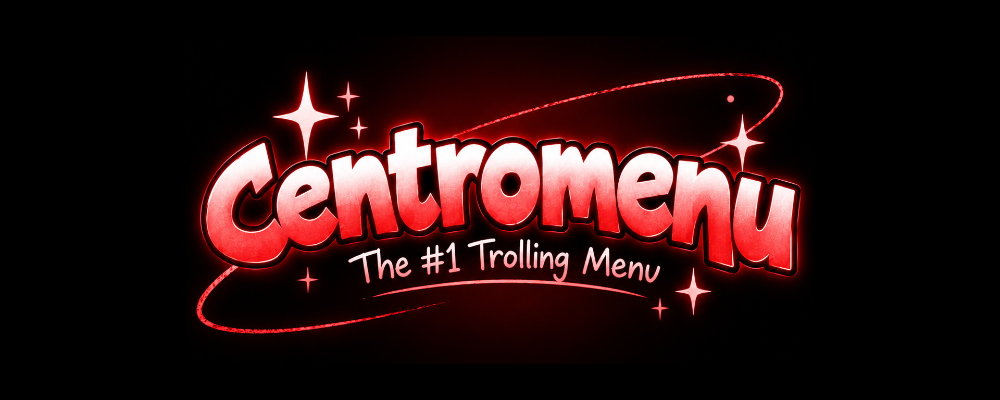

  

  <b>An easy-to-use Among Us cheat menu with a simple GUI and lots of useful modules.</b>

> [!CAUTION]
Please note that this mod menu is for host only or maybe just to have fun with your friends in a private lobby or educational purposes to study game mechanics the developers are not responsible for any Damages that affected your Among us account in any way. if you accidentally join a public lobby. you can use panic mode by doing Ctrl + F1.

# NOTICE

> [!IMPORTANT]
> We as the developers who participated in this project are not responsible for any damages that have affected your Innersloth LLC among us account in any way.

# Mod Menu's Features 🎮

* Noclip
---------------------------------------------------------------------------
* Sabotaging Mechanics - Sabotaging reactor oxygen etc.
---------------------------------------------------------------------------
* Kicking all players
---------------------------------------------------------------------------
* See ghost chat / See ghosts in game
---------------------------------------------------------------------------
* Teleport people to different vents
---------------------------------------------------------------------------
* Show imposters
---------------------------------------------------------------------------
* ESP
---------------------------------------------------------------------------
* Unlock every Cosmetic for free
---------------------------------------------------------------------------
* Notifications and a API (that you can possibly use in your mod menu)

